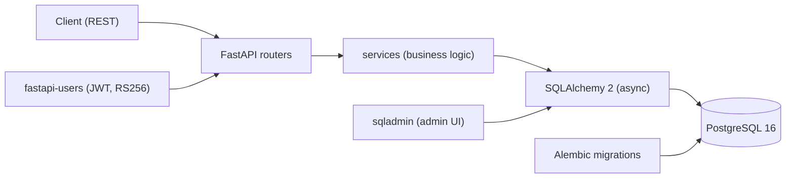
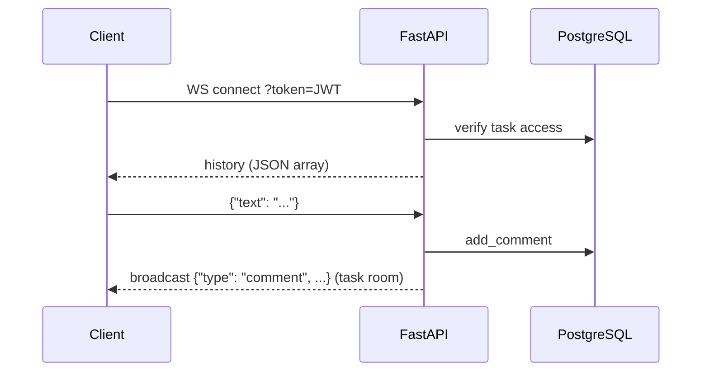

[English](README.md) | [Русский](README.ru.md)

# Business Management System

[](https://github.com/annaputilovskaya/BusinessManagementSystem/actions/workflows/ci.yml)
[](https://github.com/annaputilovskaya/BusinessManagementSystem/actions/workflows/ci.yml)
[](LICENSE)
[](https://www.python.org/downloads/)
[](https://fastapi.tiangolo.com/)

A team management API for a company: role-based users, teams, tasks with
real-time comments over WebSocket, meetings, performance evaluations and a
calendar.

## Features

### 1. Users (administrator, manager and regular user roles)

- Self-registration with email and password
- Authorization / logout
- Profile update
- Account deletion (no recovery)


### 2. Teams

- Create a team (administrator)
- Add/remove users in a team (administrator)
- View team composition (all users)
- Assign roles to users inside a team (administrator)


### 3. Tasks

- Create tasks (manager)
- Assign an executor (manager)
- Change status (executor)
- Edit/delete (manager)
- Real-time comments over WebSocket inside a task (manager and executor)


### 4. Work evaluation

- A manager scores completed tasks: 1 to 5 points
- A user sees their scores
- Average score over a period


### 5. Meetings

- Schedule a meeting: date, time, participants (user)
- Time check to avoid overlapping events
- List of the user's meetings (meeting participant)
- Ability to cancel a meeting (meeting participant)


### 6. Calendar

- Display tasks and meetings for a day
- Display tasks and meetings for a month


## Stack

- **Language / framework:** Python 3.11, FastAPI
- **ORM / migrations:** SQLAlchemy 2 (async) + Alembic
- **Database:** PostgreSQL 16
- **Auth / admin:** fastapi-users (JWT, RS256), sqladmin
- **Runtime / tooling:** Docker, docker compose, Poetry
- **Quality:** pytest, pytest-cov, ruff (see [Tests](#tests))

## Architecture



## Data model


## Real-time comments

Task comments are streamed over WebSocket: `ws /tasks/{task_id}/comments/?token=<jwt>`.

- On connect the server sends the comment history as a JSON array:
  `[{"type": "comment", "user_id": "...", "text": "...", "created_at": "..."}]`
- Clients send `{"text": "..."}`; the server saves the comment and broadcasts
  `{"type": "comment", ...}` to every member connected to that task room.
- Invalid frames get `{"type": "error", ...}` without dropping the connection.
- Missing/invalid token or a task outside your team closes the socket with code 1008.



## Getting started

### Prerequisites

- Python 3.11+
- [Poetry](https://python-poetry.org/)
- Docker (with docker compose)

### Clone and configure

```bash
git clone https://github.com/annaputilovskaya/BusinessManagementSystem.git
cd BusinessManagementSystem
cp .env.example .env   # Unix; on Windows copy the file manually
```

Fill `.env` with your Postgres credentials, `ALGORITHM=RS256` and token
secrets (see [Configuration](#configuration)).

Generate the JWT certificates for RS256:

```bash
mkdir -p src/auth/certs
openssl genrsa -out src/auth/certs/jwt-private.pem 2048
openssl rsa -in src/auth/certs/jwt-private.pem -pubout -out src/auth/certs/jwt-public.pem
```

Check that Docker is installed:

```bash
docker --version
```

If Docker is not installed, [install it following the official
instructions](https://www.docker.com/).

### Build and run

```bash
docker compose up -d --build
```

The application is available at <http://localhost:8000>, interactive API docs
(Swagger) at <http://localhost:8000/docs>.

## Configuration

All variables are read from `.env` (see `.env.example`).

| Variable | Description | Default |
|---|---|---|
| `POSTGRES_ENGINE` | SQLAlchemy async driver | — |
| `POSTGRES_USER` | Postgres user | — |
| `POSTGRES_PASSWORD` | Postgres password | — |
| `POSTGRES_HOST` | Postgres host | — |
| `POSTGRES_PORT` | Postgres port | — |
| `POSTGRES_DB` | Database name | — |
| `POSTGRES_ECHO` | SQL echo (`0`/`1`) | — |
| `ALGORITHM` | JWT algorithm (RS256) | — |
| `RESET_PASSWORD_TOKEN_SECRET` | Secret for reset-password tokens | — |
| `VERIFICATION_TOKEN_SECRET` | Secret for verification tokens | — |
| `ADMIN_SECRET_KEY` | Secret for signing the admin session | — |

## Tests

```bash
poetry install
docker compose up -d db        # local Postgres for tests
poetry run pytest --cov=src --cov-fail-under=55
```

Coverage gate: **55%** overall, core business logic (services) **≥ 70%**.
Integration tests run against an isolated test database (`test_<POSTGRES_DB>`)
with migrations applied automatically by the test fixtures.

## Project structure

```
src/
  admin/      # sqladmin views
  alembic/    # migrations
  auth/       # fastapi-users backend, JWT (RS256)
  models/     # SQLAlchemy models (User, Team, Task, Comment, Meeting, Evaluation)
  routers/    # FastAPI routers (users, teams, tasks, meetings, evaluations, schedule)
  schemas/    # Pydantic schemas
  services/   # business logic
tests/        # pytest suite (integration tests on an isolated test DB)
```

## License

MIT — see [LICENSE](LICENSE).
