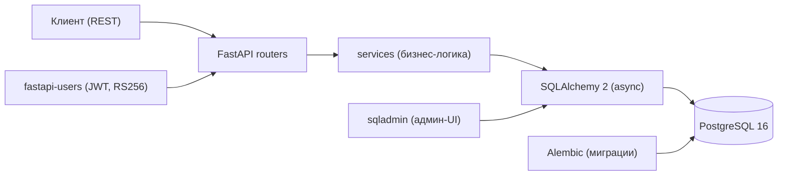
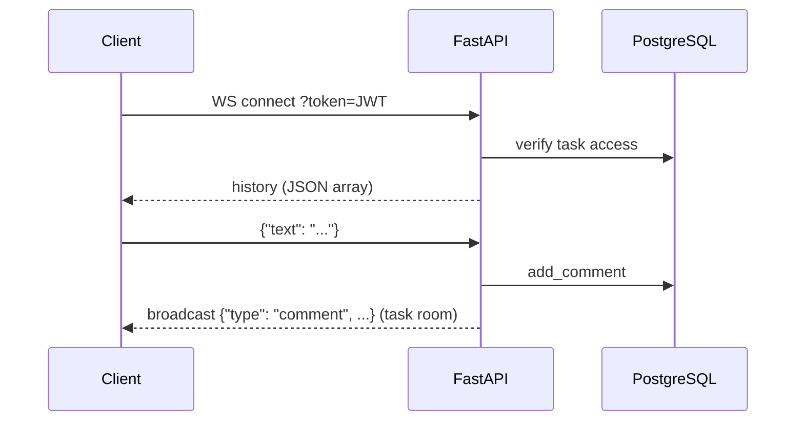

[English](README.md) | [Русский](README.ru.md)

# Система управления бизнесом

[](https://github.com/annaputilovskaya/BusinessManagementSystem/actions/workflows/ci.yml)
[](https://github.com/annaputilovskaya/BusinessManagementSystem/actions/workflows/ci.yml)
[](LICENSE)
[](https://www.python.org/downloads/)
[](https://fastapi.tiangolo.com/)

API для управления командой внутри компании: пользователи с ролями, команды,
задачи с комментариями в реальном времени (WebSocket), встречи, оценка работы и
календарь.

## Возможности

### 1. Пользователи (роли: администратор, менеджер, обычный пользователь)

- Самостоятельная регистрация с email и паролем
- Авторизация / выход
- Обновление профиля
- Удаление аккаунта (без восстановления)


### 2. Команды

- Создание команды (администратор)
- Добавление/удаление пользователей в команде (администратор)
- Просмотр состава команды (все пользователи)
- Назначение пользователям ролей в команде (администратор)


### 3. Задачи

- Создание задач руководителем (менеджер)
- Назначение исполнителя (менеджер)
- Изменение статуса (исполнитель)
- Изменение / удаление (менеджер)
- Комментарии в реальном времени (WebSocket) внутри задачи (менеджер и исполнитель)


### 4. Оценка работы

- Руководитель оценивает выполненные задачи: баллы от 1 до 5
- Пользователь видит свои оценки
- Вывод средней оценки за период


### 5. Встречи

- Назначение встречи: дата, время, участники (пользователь)
- Проверка времени, чтобы не накладывались события
- Список встреч пользователя (участник встречи)
- Возможность отменить встречу (участник встречи)


### 6. Календарь

- Отображение задач и встреч за день
- Отображение задач и встреч за месяц


## Стек

- **Язык / фреймворк:** Python 3.11, FastAPI
- **ORM / миграции:** SQLAlchemy 2 (async) + Alembic
- **Хранение данных:** PostgreSQL 16
- **Auth / admin:** fastapi-users (JWT, RS256), sqladmin
- **Запуск / инструменты:** Docker, docker compose, Poetry
- **Качество:** pytest, pytest-cov, ruff (см. [Тесты](#тесты))

## Архитектура



## Модель данных


## Комментарии в реальном времени

Комментарии к задачам передаются по WebSocket: `ws /tasks/{task_id}/comments/?token=<jwt>`.

- При подключении сервер отправляет историю комментариев как JSON-массив:
  `[{"type": "comment", "user_id": "...", "text": "...", "created_at": "..."}]`
- Клиенты отправляют `{"text": "..."}`; сервер сохраняет комментарий и рассылает
  `{"type": "comment", ...}` всем участникам, подключённым к комнате этой задачи.
- Некорректные кадры получают `{"type": "error", ...}` без разрыва соединения.
- Отсутствующий/недействительный токен или задача вне вашей команды закрывают
  соединение с кодом 1008.



## Запуск

### Требования

- Python 3.11+
- [Poetry](https://python-poetry.org/)
- Docker (с docker compose)

### Клонирование и настройка

```bash
git clone https://github.com/annaputilovskaya/BusinessManagementSystem.git
cd BusinessManagementSystem
cp .env.example .env   # для Unix-подобных систем; в Windows скопируйте файл вручную
```

Заполните `.env` данными Postgres, `ALGORITHM=RS256` и секретами токенов
(см. [Конфигурация](#конфигурация)).

Сгенерируйте JWT-сертификаты для RS256:

```bash
mkdir -p src/auth/certs
openssl genrsa -out src/auth/certs/jwt-private.pem 2048
openssl rsa -in src/auth/certs/jwt-private.pem -pubout -out src/auth/certs/jwt-public.pem
```

Убедитесь, что установлен Docker:

```bash
docker --version
```

Если Docker не установлен,
[осуществите его установку по инструкции с официального сайта](https://www.docker.com/).

### Сборка и запуск

```bash
docker compose up -d --build
```

Приложение доступно по адресу <http://localhost:8000>, интерактивная
документация API (Swagger) — на <http://localhost:8000/docs>.

## Конфигурация

Все переменные читаются из `.env` (см. `.env.example`).

| Переменная | Описание | По умолчанию |
|---|---|---|
| `POSTGRES_ENGINE` | Async-драйвер SQLAlchemy | — |
| `POSTGRES_USER` | Пользователь Postgres | — |
| `POSTGRES_PASSWORD` | Пароль Postgres | — |
| `POSTGRES_HOST` | Хост Postgres | — |
| `POSTGRES_PORT` | Порт Postgres | — |
| `POSTGRES_DB` | Имя базы данных | — |
| `POSTGRES_ECHO` | SQL-echo (`0`/`1`) | — |
| `ALGORITHM` | Алгоритм JWT (RS256) | — |
| `RESET_PASSWORD_TOKEN_SECRET` | Секрет токенов сброса пароля | — |
| `VERIFICATION_TOKEN_SECRET` | Секрет токенов верификации | — |
| `ADMIN_SECRET_KEY` | Секрет для подписи сессии админки | — |

## Тесты

```bash
poetry install
docker compose up -d db        # локальный Postgres для тестов
poetry run pytest --cov=src --cov-fail-under=55
```

Порог покрытия: **55%** общий, ядро бизнес-логики (services) **≥ 70%**.
Интеграционные тесты выполняются на изолированной тестовой БД
(`test_<POSTGRES_DB>`), миграции применяются автоматически фикстурами.

## Структура проекта

```
src/
  admin/      # представления sqladmin
  alembic/    # миграции
  auth/       # бэкенд fastapi-users, JWT (RS256)
  models/     # модели SQLAlchemy (User, Team, Task, Comment, Meeting, Evaluation)
  routers/    # роутеры FastAPI (users, teams, tasks, meetings, evaluations, schedule)
  schemas/    # Pydantic-схемы
  services/   # бизнес-логика
tests/        # набор pytest (интеграционные тесты на изолированной БД)
```

## Лицензия

MIT — см. [LICENSE](LICENSE).
